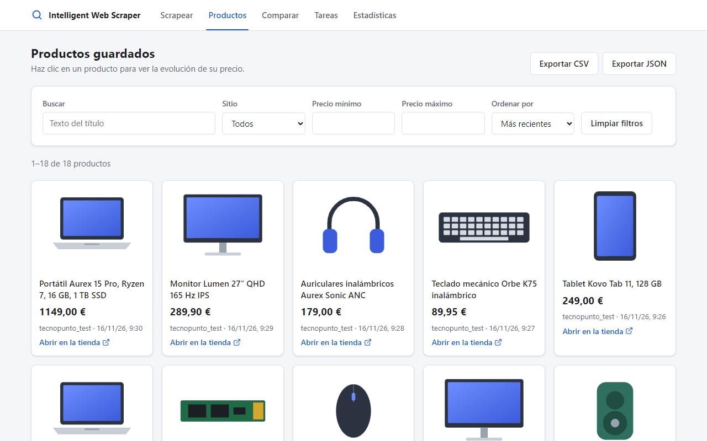

# Intelligent Web Scraper

Herramienta en Python que extrae listados de productos de páginas web, guarda
sus precios e historial en SQLite y permite consultarlos, compararlos y
programar su actualización desde una interfaz web local o un menú de consola.


[](LICENSE)



*Datos de ejemplo de una tienda ficticia. Más capturas en [docs/interfaz-web.md](docs/interfaz-web.md).*

## Características

- Extracción genérica de listados (título, precio, descripción, enlace e
  imagen) sin configurar cada sitio.
- Primero sin navegador (requests y BeautifulSoup); Chrome con Selenium solo
  si la página lo necesita.
- Precios en formato español e inglés guardados como importe y moneda, con
  historial por producto.
- Paginación, comparación de precios entre dos sitios y tareas programadas.
- Interfaz web local con API JSON, y menú de consola con las mismas funciones.
- Exportación a CSV y JSON.
- Ejecutable para Windows generado con PyInstaller.

## Inicio rápido

Requisitos: Python (probado con 3.13) y Google Chrome para las páginas que
necesitan navegador.

Windows (PowerShell):

```powershell
git clone https://github.com/Frxnker/intelligent-web-scraper.git
cd intelligent-web-scraper
python -m venv .venv
.venv\Scripts\Activate.ps1
pip install -r requirements.txt
python servidor.py
```

Si PowerShell no permite ejecutar `Activate.ps1`, usa `.venv\Scripts\activate.bat`
desde `cmd` o ejecuta `Set-ExecutionPolicy -Scope CurrentUser RemoteSigned`.

Linux y macOS:

```bash
git clone https://github.com/Frxnker/intelligent-web-scraper.git
cd intelligent-web-scraper
python3 -m venv .venv
source .venv/bin/activate
pip install -r requirements.txt
python servidor.py
```

La interfaz se abre en <http://127.0.0.1:8000>. Para pararla, Ctrl+C en la
consola.

## Uso

**Interfaz web.** `python servidor.py` abre en el navegador las pestañas
Scrapear, Productos, Comparar, Tareas y Estadísticas. Los scrapings se ejecutan
en segundo plano con una barra de progreso.

**Menú de consola.** `python main.py` ofrece las mismas funciones en un menú de
12 opciones. Las dos formas comparten la base de datos y la carpeta `output/`.

## Documentación

- [Interfaz web](docs/interfaz-web.md): pestañas, opciones de `servidor.py` y
  cómo generar el `.exe`.
- [API](docs/api.md): rutas, parámetros y formato de errores.
- [Menú de consola](docs/consola.md): opciones, archivos generados y uso desde
  código.
- [Cómo funciona](docs/funcionamiento.md): extracción, uso de Selenium,
  paginación y comparación.
- [Precios](docs/precios.md): formatos admitidos y reglas de interpretación.
- [Base de datos](docs/base-de-datos.md): tablas y migración.
- [Configuración](docs/configuracion.md): opciones de `config.py`.
- [Desarrollo](docs/desarrollo.md): estructura del proyecto y tests.
- [Limitaciones](docs/limitaciones.md): lista completa.

## Limitaciones

- La extracción usa heurísticas: puede tomar elementos que no son productos o
  no reconocer el listado.
- Los sitios cambian su HTML; los scripts específicos (Amazon, PcComponentes,
  eBay, AliExpress) pueden dejar de funcionar en cualquier momento.
- Muchas tiendas bloquean el acceso automatizado, y la herramienta no intenta
  saltarse esas protecciones.
- Las tareas programadas solo se ejecutan mientras el programa está abierto.
- La interfaz web no tiene usuarios ni contraseñas: está pensada para uso local.

Lista completa en [docs/limitaciones.md](docs/limitaciones.md).

## Uso responsable

Antes de scrapear un sitio, lee sus términos de uso y respeta su `robots.txt`
(la herramienta no lo comprueba automáticamente). Usa pausas e intervalos
amplios para no sobrecargar los servidores y no recojas datos personales.

## Licencia

[MIT](LICENSE). Copyright (c) 2026 Francisco López Lobanova.
