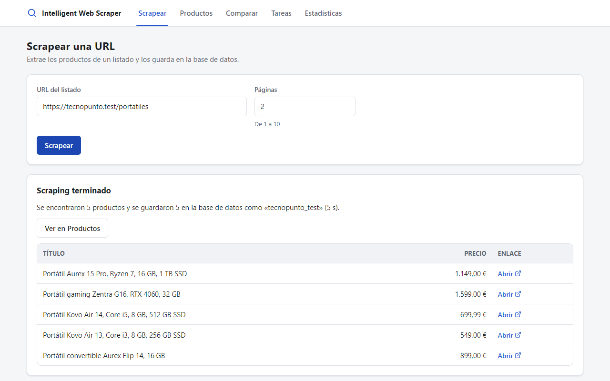
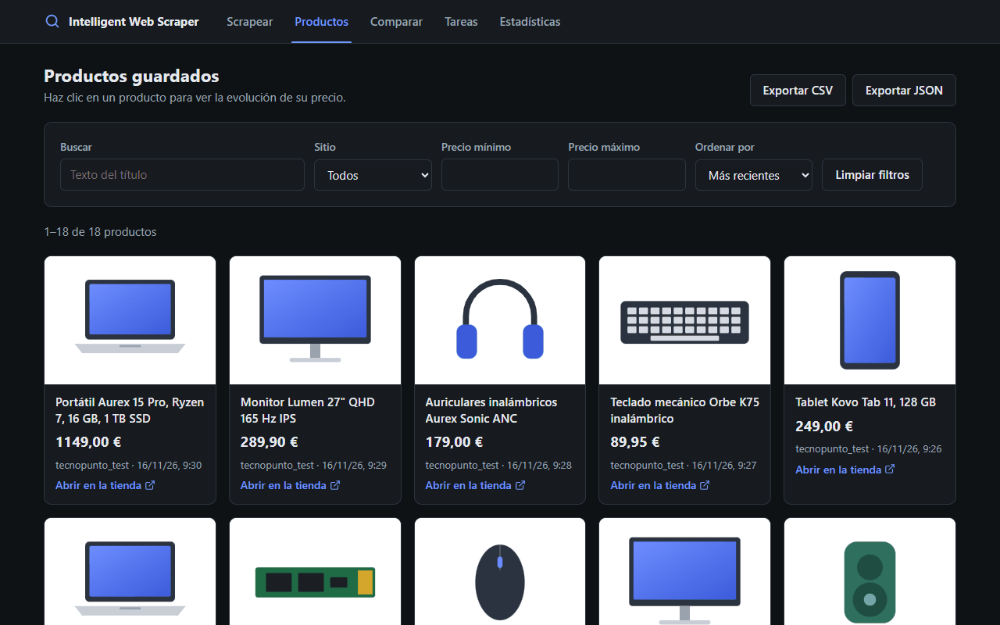
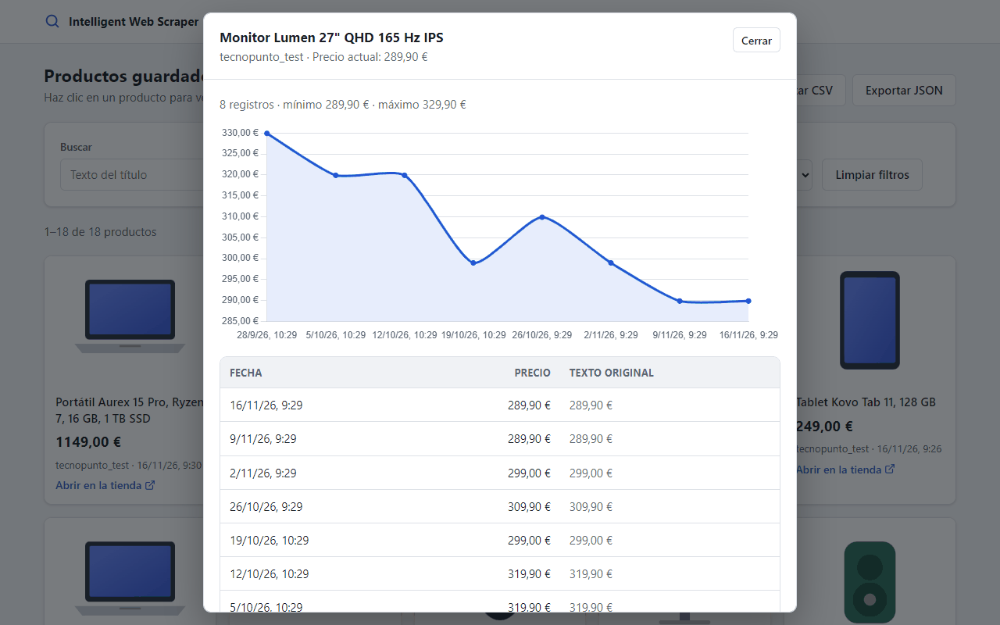
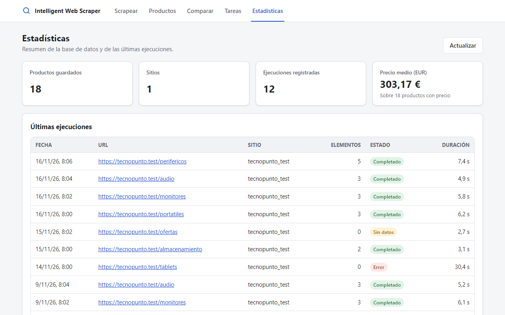

# Interfaz web

Página local servida por FastAPI que usa los mismos módulos, la misma base de
datos y los mismos archivos de `output/` que el [menú de consola](consola.md).
La API que hay detrás se describe en [api.md](api.md).

[Volver al README](../README.md)

## Arrancar el servidor

```bash
python servidor.py
```

Arranca en <http://127.0.0.1:8000> y abre el navegador cuando el servidor está
listo. La consola muestra el registro de peticiones y de los scrapings.

Para pararlo, pulsa **Ctrl+C** en la consola. Si hay un scraping en marcha, el
servidor espera a que termine la página que está descargando, cierra su
navegador y después se apaga; los trabajos que estaban en cola se cancelan. No
cierres la ventana de la consola con un scraping en marcha: Windows termina el
proceso sin dejarle cerrar el navegador.

| Opción | Por defecto | Descripción |
|--------|-------------|-------------|
| `--port N` | 8000 | Puerto. Si está ocupado, el programa lo avisa y sugiere otro |
| `--host H` | `127.0.0.1` | Dirección en la que escuchar. Con `0.0.0.0` se puede acceder desde la red local; la API no tiene usuarios ni contraseñas, así que úsalo solo en una red de confianza (el programa lo avisa al arrancar) |
| `--no-abrir` | | No abrir el navegador |

Los valores por defecto están en `config.py` (`SERVIDOR_HOST`,
`SERVIDOR_PUERTO`). Con la dirección por defecto, el servidor solo responde a
peticiones dirigidas a `127.0.0.1` o `localhost`, lo que evita que otras webs
abiertas en el navegador puedan usarlo.

El menú de consola se puede usar a la vez, pero no conviene iniciar también su
programador de tareas (ver [Limitaciones](limitaciones.md)).

## Pestañas

Las capturas de este documento usan datos de ejemplo de una tienda ficticia.

### Scrapear



URL del listado y número de páginas (de 1 a 10). Si la URL no lleva `http://`
o `https://` se añade `https://`. El scraping se ejecuta en segundo plano: una
barra de progreso indica la página por la que va (`Página 2 de 3`) y, al
terminar, se muestra cuántos productos se encontraron y se guardaron, con qué
nombre de sitio, cuánto tardó y una muestra de hasta 20 productos. El botón
"Ver en Productos" abre la pestaña Productos filtrada por ese sitio.

Si se recarga la página en la misma pestaña del navegador, se sigue el
progreso del mismo trabajo. Si el trabajo falla (por ejemplo, Chrome no puede
arrancar) se muestra el mensaje de error.

### Productos



Los productos guardados en tarjetas con imagen, título, precio, sitio, fecha
de la última vez que se vieron y enlace a la tienda, 24 por página. Se puede:

- buscar por texto en el título,
- filtrar por sitio y por rango de precio,
- ordenar por fecha, precio (de menor a mayor o al revés) o título,
- descargar con "Exportar CSV" o "Exportar JSON" los productos que cumplen los
  filtros actuales (todos, no solo la página visible).

Al hacer clic en un producto se abre su historial de precios:



El historial muestra una gráfica, el mínimo y el máximo, y una tabla con la
fecha, el precio y el texto original de cada registro. Hay un registro cada vez
que el producto se guarda con un precio reconocible.

La gráfica usa Chart.js, que se descarga de un CDN (jsDelivr). Sin conexión a
internet se muestra solo la tabla. El resto de la interfaz funciona sin
conexión, aunque scrapear necesita red.

### Comparar

Dos URLs, un nombre opcional para cada sitio y la similitud mínima de títulos
(entre 50 % y 100 %; cuanto más alta, menos coincidencias pero más fiables). La
comparación se ejecuta en segundo plano con una sola sesión de navegador para
los dos sitios. El resultado muestra:

- cuántos productos se emparejaron y cuántos se encontraron en cada sitio,
- en cuántos es más barato cada sitio,
- el ahorro total comprando cada producto en el sitio más barato,
- una tabla con cada pareja, su precio en cada sitio, la diferencia (importe y
  porcentaje) y la similitud. El precio más barato aparece marcado con "Más
  barato"; si coinciden, se indica "Mismo precio", y si las monedas son
  distintas no se comparan.

Los productos comparados no se guardan en la base de datos.

### Tareas

Crear, listar y eliminar tareas programadas: nombre (único), URL, cada cuántos
minutos se ejecuta (de 1 a 10080) y cuántas páginas scrapea (de 1 a 10). La
lista muestra la frecuencia, el número de ejecuciones y la fecha de la última y
de la próxima ejecución. Las tareas se ejecutan en segundo plano mientras el
servidor esté encendido; son las mismas que gestiona el menú de consola
(`output/tareas_programadas.json`). Cada ejecución guarda los productos con el
nombre de la tarea como sitio.

### Estadísticas



Totales de productos, sitios y ejecuciones registradas, precio medio por
moneda, las 10 últimas ejecuciones (de la consola, la web o el programador) con
su estado y duración, y los productos por sitio. El botón "Actualizar" vuelve
a cargar los datos.

Estados de una ejecución: Completado, Sin datos (la página se descargó pero no
se encontró ningún producto), Error y Cancelado (el servidor se cerró a mitad).

## Generar el ejecutable (.exe)

En Windows:

```powershell
pip install -r requirements-dev.txt
pyinstaller --noconfirm --clean intelligent-web-scraper.spec
```

Se genera `dist\IntelligentWebScraper.exe`, un único archivo que hace lo mismo
que `python servidor.py` y acepta las mismas opciones (`--port`, `--host`,
`--no-abrir`). Las carpetas `build/` y `dist/` no se suben al repositorio.

- Al ejecutarlo crea `output\` (base de datos, CSV, JSON y tareas) junto al
  `.exe`, sea cual sea la carpeta desde la que se lance.
- Tarda unos segundos en arrancar porque cada vez descomprime su contenido en
  una carpeta temporal.
- Se abre con una ventana de consola, que muestra el registro y permite
  pararlo con Ctrl+C.
- No incluye Google Chrome: el equipo tiene que tenerlo instalado para las
  páginas que necesitan navegador. El chromedriver lo descarga Selenium
  Manager la primera vez (necesita internet).
- Algunos antivirus desconfían de los ejecutables generados con PyInstaller.

El archivo `intelligent-web-scraper.spec` incluye en el ejecutable la interfaz
(`web/static`), `schema.sql`, `scripts.js` y los archivos internos de Selenium
y Uvicorn que se cargan de forma dinámica. En Linux o macOS el mismo comando
genera `dist/IntelligentWebScraper` para ese sistema; PyInstaller no genera
ejecutables para otros sistemas operativos.
